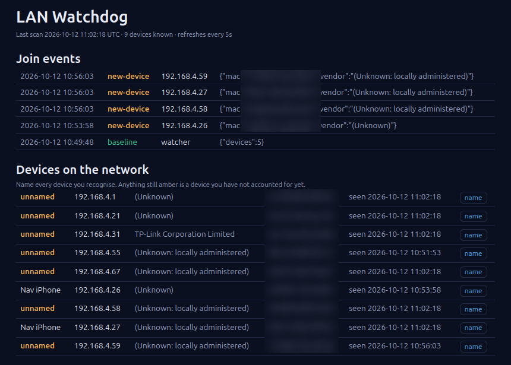

# lan-watchdog

A small learning project: **how would you notice an unfamiliar device on your own network?**

I'm a support analyst working towards network and cloud roles. I wanted to understand how anomaly detection works at the network level, so I built the simplest useful version I could and wrote down what I learned. It is a learning tool, not a security product.



## The idea in one paragraph

Every couple of minutes it asks the local network "who's here?" using ARP, remembers every device it has ever seen (the *baseline*), and tells me the moment something unfamiliar shows up. It also watches for one IP address being claimed by two different devices, which is a classic sign of ARP spoofing.

## What it does

| Event | Meaning |
|---|---|
| `baseline` | First scan ever. It just learns what is normal and does not alert. |
| `new-device` | A MAC address it has never seen before joined the network. |
| `arp-conflict` | Two different MACs answered for one IP address. |

New events go to a live dashboard (`http://localhost:8088`) and, if configured, a webhook (Discord, Slack or Teams) so my phone buzzes. The dashboard also lists every known device. You can name the ones you recognise, and anything still marked "unnamed" is a device you haven't accounted for yet.

```
  home network
       |  ARP "who has 192.168.1.x?" every 2 min
       v
  arp-scan  -->  watch.py (compare with baseline)  -->  events.jsonl  -->  dashboard :8088
                       |                                                  webhook alert
                  devices.json (the baseline)
```

One container, a few hundred lines of Python. Pieces: `arp-scan` for discovery, `watch.py` for the baseline logic, `main.py` for the dashboard, `common.py` for logging and alerts.

## Run it (Linux host, e.g. Ubuntu)

```bash
cp .env.example .env        # optionally add ALERT_WEBHOOK_URL
docker compose up -d --build
```

Open `http://localhost:8088`. Give the first scan a moment, then name your devices. After that, join the Wi-Fi with a phone that has never connected and watch for the `new-device` event within a scan or two.

If the scan fails with a permission error, check `docker compose logs` and try adding `NET_ADMIN` under `cap_add`.

## What I learned

- **My own phone looked like an intruder.** I turned off Private Wi-Fi Address on my iPhone, which changed its MAC, and the tool flagged it as a new device within a couple of minutes. A few minutes later more private-address devices showed up. Detection tells you *something changed*, not *who it is*, so you still have to identify devices yourself (I used my router app).
- **ARP is trust-based.** Any device on the LAN can answer "I'm 192.168.1.1", and nothing checks. That is why spoofing is possible and why a conflict check is a useful signal.
- **A baseline beats a rulebook.** I never have to say what a bad device looks like; I only have to say what normal looks like.
- **Detection needs tuning.** Phones use randomised MAC addresses by default, so one phone can look like a "new device" each time it reconnects. That is a real source of false alarms.
- **Containers need to be on the real network.** Scanning a LAN from a container needs host networking and the `NET_RAW` capability, and it does not work on Docker Desktop for Windows or macOS.
- **Small details matter.** Alerts need a cooldown, and a conflict should be reported when it appears, not on every scan.

## Limits (being honest)

- Only sees its own subnet. Guest Wi-Fi or other VLANs would need their own watcher.
- MAC addresses can be spoofed and randomised, so a hit means "go and look", not "intruder".
- The dashboard has no login. Run it on a trusted home LAN only, never expose it to the internet.
- The baseline is trust-on-first-use: anything already on the network during the first scan is assumed to be fine.

## Where I want to take it next

- Handle MAC randomisation so phones stop looking like strangers
- Add a DNS layer by reading my Pi-hole's query log for devices behaving oddly
- Send events to Azure Monitor and alert with a KQL query
- Add a login to the dashboard
